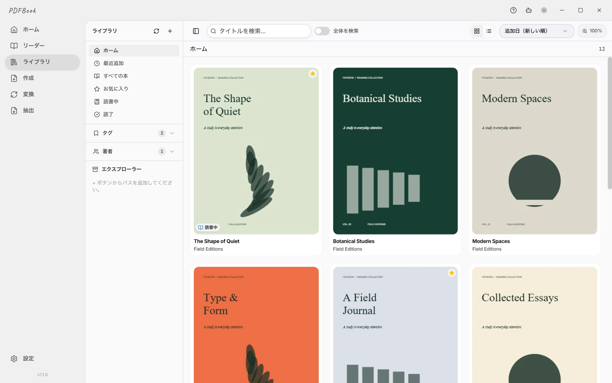
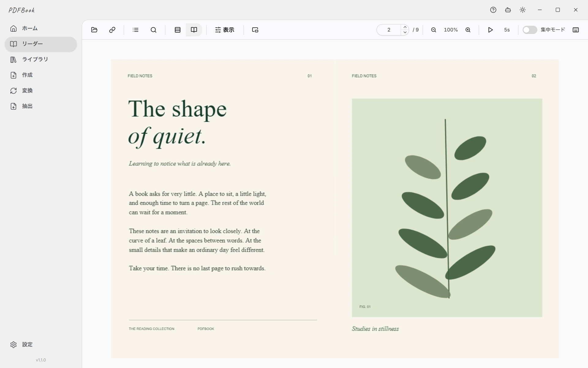

# PDFBook — PDFリーダー・ライブラリ管理

本、マンガ、論文、スキャン資料を、ひとつのデスクトップアプリで。**Windows・macOS・Linux** でPDFを整理し、前回の続きから読み始められます。

**[PDFBookをダウンロード](https://github.com/YumeBytesLab/PDFBook/releases/latest)** · [公式サイト](https://pdfbook.app/ja) · [使い方ガイド](https://wiki.pdfbook.app/ja/) · [English](README.md)

## 手元のPDFを、読みやすい本棚に

- **本やマンガを読む：** ページめくりと縦スクロール、単ページと見開き、右綴じに対応。
- **論文や資料を読み進める：** 文書内検索、しおり、PDF内の目次、最前面に置けるフローティングリーダー。
- **ライブラリを整理する：** フォルダ、タグ、評価、お気に入り、読書状態、本ごとのメモ。監視フォルダを再スキャンして追加ファイルを取り込めます。
- **PDFを作成・変換する：** JPG・PNG画像をまとめてPDFに。対応する文書・電子書籍形式の変換や、PDFに埋め込まれた画像の抽出もできます。
- **必要なときにAIを使う：** 自分のプロバイダーやローカルのOllamaに接続できます。AIサービスの利用料はPDFBookには含まれません。

## ダウンロード

[最新リリース](https://github.com/YumeBytesLab/PDFBook/releases/latest)から、OSとCPUに合うファイルを選んでください。

| OS | 配布形式 |
| --- | --- |
| Windows 10 / 11 | Setup・Portable、**x64 / ARM64** |
| macOS | **Apple Silicon (ARM64)**・**Intel (x64)** 向けDMG |
| Linux | AppImage・deb、**x64 / amd64・ARM64** |

選び方と初回起動の案内は[インストールガイド](https://wiki.pdfbook.app/ja/download/)にあります。Windowsの通常配布版は未署名、macOS版はDeveloper ID署名・公証を行っていません。

Microsoft Store版は公開準備中です。Release内の `.appx` は未署名の提出用パッケージなので、通常のインストールにはSetupかPortableを使ってください。

## 無料プランと有料プラン

無料プランのライブラリは **50冊まで**。フローティングリーダーは初回セッションが時間制限なしで、その後は **月60分の実読時間** を使えます。Pro・Lifetimeでは、この冊数とフローティングリーダーの時間の制限がなくなります。

AIとの会話には自分で設定したプロバイダーを使います。AIによるページ読み取り・アプリ操作には有料プランが必要で、外部プロバイダーの料金は別途かかります。[現在の料金とプラン](https://pdfbook.app/ja#pricing)をご覧ください。

## ファイルとプライバシー

PDFの読書、ライブラリの保存、PDF作成・変換はPC内で動作し、読むためのアカウント登録は不要です。クラウドAIを使う場合は、メッセージ、会話の文脈、読み取りを依頼した文書のテキストやページ画像が設定先へ送信されます。ローカルのOllamaを使えば、AIへのリクエストも端末内で処理できます。

[プライバシーポリシー](https://pdfbook.app/ja/privacy) · [AIの使い方](https://wiki.pdfbook.app/ja/features/ai-assistant/)

## ガイド・問い合わせ

- [はじめに](https://wiki.pdfbook.app/ja/getting-started/) · [リーダー](https://wiki.pdfbook.app/ja/features/reader/) · [ライブラリ管理](https://wiki.pdfbook.app/ja/features/library/)
- [FAQ](https://wiki.pdfbook.app/ja/faq/) · [不具合を報告](https://github.com/YumeBytesLab/PDFBook/issues/new/choose) · [質問・相談](https://github.com/YumeBytesLab/PDFBook/discussions)
- [問い合わせ](https://pdfbook.app/ja/contact) · [脆弱性の報告](SECURITY.md)

不具合の報告には、PDFBookのバージョン、OS、CPU、再現手順を添えてください。添付する資料や画像から個人情報を取り除いてください。

## このリポジトリについて

[YumeBytes](https://pdfbook.app)が管理する、**PDFBookの配布・ドキュメント用リポジトリ**です。デスクトップアプリ本体はクローズドソースで、このリポジトリには本体のソースコードを含みません。

ドキュメントの編集方法は[編集ガイド](.github/CONTRIBUTING.md)をご覧ください。
