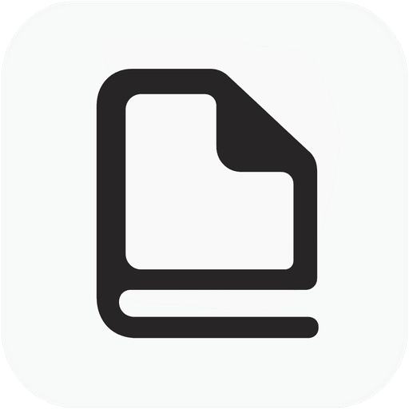
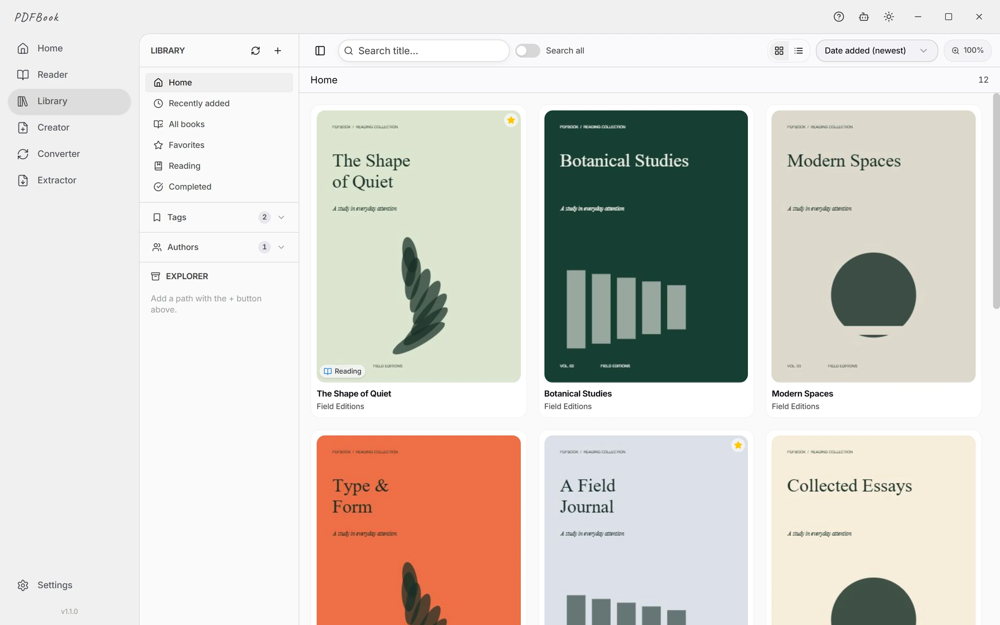
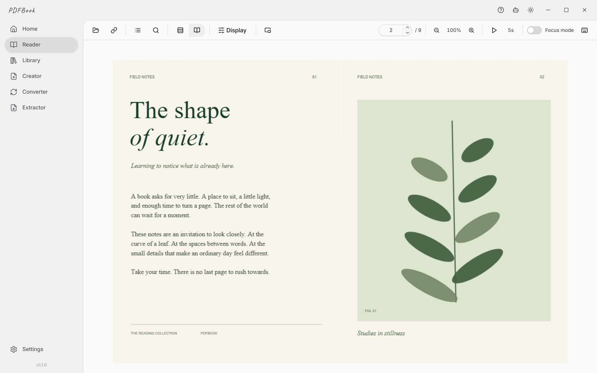

  

<h1 align="center">PDFBook</h1>

  <strong>让手边的 PDF，成为自己的书架。</strong> 
  适用于 Windows、macOS 和 Linux 的 PDF 阅读器与书库管理工具。

  
  

  <strong><a href="https://github.com/YumeBytesLab/PDFBook/releases/latest">下载 PDFBook</a></strong> &nbsp; · &nbsp;
  <a href="https://pdfbook.app/zh">官方网站</a> &nbsp; · &nbsp;
  <a href="https://wiki.pdfbook.app/zh/">使用指南</a>

<a href="../README.md">English</a> &nbsp; / &nbsp; <a href="../README.ja.md">日本語</a> &nbsp; / &nbsp; <strong><a href="../readme/README.zh-CN.md">简体中文</a></strong> &nbsp; / &nbsp; <a href="../readme/README.ko.md">한국어</a> &nbsp; / &nbsp; <a href="../readme/README.es.md">Español</a> &nbsp; / &nbsp; <a href="../readme/README.fr.md">Français</a> 
<a href="../readme/README.de.md">Deutsch</a> &nbsp; / &nbsp; <a href="../readme/README.pt-BR.md">Português (Brasil)</a> &nbsp; / &nbsp; <a href="../readme/README.ru.md">Русский</a> &nbsp; / &nbsp; <a href="../readme/README.it.md">Italiano</a> &nbsp; / &nbsp; <a href="../readme/README.id.md">Bahasa Indonesia</a> &nbsp; / &nbsp; <a href="../readme/README.vi.md">Tiếng Việt</a>

---

真实应用截图（英语界面）· 应用界面支持 12 种语言 · 可免费开始使用

## 找到下一本书，接着读下去

把文件夹中的 PDF 整理成封面书架。阅读书籍、漫画、论文和扫描资料；启用阅读位置记忆后，可从上次停下的地方继续。

| 用途 | 你可以这样使用 |
| --- | --- |
| **书籍与漫画** | 翻页或纵向滚动、单页或双页显示，并支持从右向左阅读。 |
| **论文与资料** | 文本搜索、书签、PDF 自带目录，以及始终置顶的悬浮阅读器。 |
| **整理书库** | 文件夹、标签、评分、收藏、阅读状态和每本书的笔记。重新扫描监视文件夹以导入新文件。 |
| **PDF 工具** | 将 JPG/PNG 图片合成为 PDF，转换支持的文档与电子书格式，提取 PDF 中嵌入的图片。 |
| **可选 AI** | 连接自己的服务商或本地 Ollama 模型。 |

## 下载与安装

从 **[最新版本](https://github.com/YumeBytesLab/PDFBook/releases/latest)** 中选择适合操作系统和 CPU 的文件。

| 系统 | 格式 | CPU |
| --- | --- | --- |
| Windows 10 / 11 | Setup / Portable | x64 / ARM64 |
| macOS | DMG | Apple Silicon (ARM64) / Intel (x64) |
| Linux | AppImage / deb | x64 / amd64 / ARM64 |

Windows 独立发行版尚未签名；macOS 版尚未使用 Developer ID 签名或进行公证。请参阅[安装指南](https://wiki.pdfbook.app/zh/download/)。Microsoft Store 版正在准备中；Windows 用户请使用 **Setup 或 Portable**。

## 从免费书库开始

免费版支持 **最多 50 本书**。悬浮阅读器首次会话不限时，之后每个自然月提供 **60 分钟实际阅读时间**。Pro / Lifetime 取消这两项限制。

AI 聊天使用你自己配置的服务商；AI 页面读取和应用操作工具需要付费方案。服务商费用另计，PDFBook 不包含 AI 订阅。[方案与价格](https://pdfbook.app/zh#pricing)。

## 文件与隐私

PDF 阅读、书库保存、PDF 创建和转换在本机进行，**阅读无需注册账户**。启用云端 AI 后，消息、对话上下文，以及请求读取的文档文本或页面图片会发送给配置的服务商。使用本地 Ollama 模型可将这些 AI 请求保留在设备内。[隐私政策（英语）](https://pdfbook.app/privacy)。

## 指南与支持

[入门](https://wiki.pdfbook.app/zh/getting-started/) · [阅读器](https://wiki.pdfbook.app/zh/features/reader/) · [常见问题](https://wiki.pdfbook.app/zh/faq/)

[报告问题](https://github.com/YumeBytesLab/PDFBook/issues/new/choose) · [讨论](https://github.com/YumeBytesLab/PDFBook/discussions) · [联系支持（英语）](https://pdfbook.app/contact) · [安全政策（英语）](../SECURITY.md)

报告问题时请提供应用版本、操作系统、CPU 和复现步骤；请勿附上私人文档或个人信息。

---

### 关于此仓库

这是 [YumeBytes](https://pdfbook.app) 维护的 **PDFBook 官方下载与文档仓库**。桌面应用为 **闭源软件**；此仓库包含文档网站。应用界面与本产品介绍支持 12 种语言。

截图为 PDFBook 1.1.0 的英语界面；1.1.1 仅更新打包流程，所示界面未变。[图片来源](../public/images/README.md) · [文档贡献指南（英语）](../.github/CONTRIBUTING.md)。
